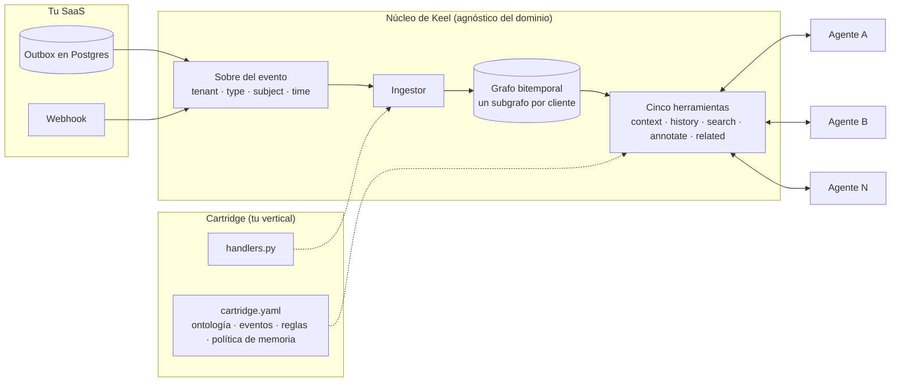

{/* Borrador. La escena inicial usa el stream de ejemplo de examples/events/fleet.jsonl (unidad MXK-4821, llanta T-9001). Cámbiala por el incidente y el producto reales si quieres. Todo lo que se dice del código es cierto para keel 0.0.1. */}

El cuarto agente fue el que me rompió. No porque fuera difícil de construir. Porque fue fácil, y ya lo había construido antes. Tres veces.

Esta es la escena. Un SaaS de gestión de flotas. Un camión, MXK-4821. Una de sus llantas, la T-9001, midió 5.2 mm de profundidad el 10 de septiembre y 2.6 mm el 3 de octubre. La regla del producto dice que una llanta es crítica por debajo de 3 mm. Hecho simple, regla simple. Ahora pregúntale a los cuatro agentes que teníamos corriendo si esa llanta está bien.

El agente de inspecciones dice que crítica. Lee la tabla de inspecciones directamente y vio la medición de octubre. El programador de mantenimiento dice que no hay nada que programar, porque solo mira tickets abiertos y nadie abrió uno. El agente de anomalías de combustible no tiene opinión sobre llantas; nunca ha oído hablar de ellas. Y el agente de soporte, el que de verdad habla con el cliente, dice que la llanta está bien, porque su contexto se armó en septiembre y nadie le avisó que el mundo se movió.

Cuatro agentes, cuatro respuestas, una llanta.

Eso no es un bug en ninguno de los cuatro. Cada uno hace exactamente lo que se construyó para hacer. El bug es que construimos cuatro, y debajo de cada uno construimos el mismo pipeline: extraer los datos del cliente de nuestra propia base de datos, normalizarlos a algo que un modelo pueda leer, decidir qué significa "crítico", darle memoria al agente, exponerle herramientas al modelo. Cuatro copias del contexto del cliente. Cuatro definiciones de crítico. Cuatro memorias que nunca se hablan.

Me pasé un fin de semana escribiendo qué haría falta para no hacerlo una quinta vez. El resultado es [Keel](https://github.com/angelkurten/keel), que publico hoy como open source, pre-alpha, con la tesis en la primera línea del README: **deja de reconstruir el pipeline para cada agente.**

## El pipeline que nadie presupuesta

Cuando planeas un agente, presupuestas el agente: el prompt, las herramientas, los evals, el framework. En lo que de verdad se te va el tiempo es en todo lo que hay debajo.

Todo agente dentro de un SaaS vertical necesita las mismas cinco cosas antes de ser útil. Necesita **extraer** la porción de datos del cliente que importa para su trabajo. Necesita **normalizar** esa porción a una forma sobre la que un modelo pueda razonar, porque una tabla `tires` con once columnas y tres foreign keys no es esa forma. Necesita **semántica**: qué cuenta como crítico, qué cuenta como vencido, qué cuenta como anómalo. Necesita una **memoria**, porque un agente que concluye algo el lunes y lo olvida el martes es una función sin estado carísima. Y necesita **herramientas**, la superficie que el modelo invoca.

Nada de eso es el agente. Todo eso es el pipeline. Y al pipeline se fue el presupuesto del primer agente, y el del segundo, y el del tercero.

El costo no es el código. Copiar un pipeline es rápido; por eso mismo lo hicimos cuatro veces. El costo es la deriva. "Crítico" estaba definido en cuatro prompts, y dos de ellos ya no coincidían cuando alguien se dio cuenta. El caché del agente de soporte se reconstruía cada noche y el del agente de inspecciones cada hora, así que durante veintitrés horas al día vivían en mundos distintos. Cuando el agente de soporte aprendía algo útil en una conversación, ese conocimiento iba a su propia memoria y moría ahí. El agente de inspecciones lo habría usado. Nunca supo que existía.

Y había una pregunta que ninguno de los cuatro podía responder, que es la primera que hizo el gerente de flota del cliente: *"¿Cuándo lo supieron?"* No "¿la llanta está crítica?" sino "¿estaba crítica el 3 de octubre, y qué creía su sistema en ese momento?". Nuestra base de datos guarda el estado actual del mundo. No guarda qué era cierto en una fecha, ni qué creíamos nosotros en esa fecha. Tampoco lo guardaba ninguno de los agentes.

## Lo que probé antes de escribir una línea

No quería construir infraestructura. Probé tres cosas que ya existían.

**Vistas compartidas en Postgres.** La jugada obvia: un conjunto de vistas que todos los agentes leen, para que al menos lean lo mismo. Ayudó con la deriva durante un mes, más o menos. Pero una vista es una copia del estado actual. No tiene dimensión temporal, no registra cuándo se supo un hecho y no tiene dónde guardar lo que un agente concluye. Las memorias siguieron siendo por agente. Y los agentes seguían teniendo que normalizar la vista a algo que el modelo pudiera usar, así que el código de normalización seguía viviendo en cuatro sitios.

**Una capa de memoria.** Hay mucho trabajo bueno aquí: Zep, Mem0, AgentCore Memory, los productos de grafos de conocimiento sobre Neo4j. Leí sus docs con esperanza de verdad. Hasta donde entiendo, parten de texto. Conversaciones, documentos, entidades extraídas. Modelan la memoria por usuario, o por asistente. Es el diseño correcto para el problema que resuelven, y no es nuestro problema. Nuestros hechos no son texto; son filas con timestamps que el SaaS ya emite. Y la unidad de aislamiento no es el usuario. Es el cliente final de nuestro cliente, el tenant del tenant, con su propia flota, sus propias reglas y su propio derecho a que sus datos no se mezclen con los de la siguiente flota. No encontré una capa que partiera de eventos de dominio y particionara por esa unidad.

**RAG sobre nuestros propios datos.** Probamos indexar las tablas y la documentación operativa y dejar que el retrieval hiciera el trabajo. Da respuestas probabilísticas a preguntas que tienen respuesta exacta. La profundidad de una llanta el 3 de octubre no es algo que se recupere con un puntaje de similitud. Es un hecho, con una fuente, y ya lo tenemos.

Tres intentos, el mismo hueco: nada se sentaba entre "el SaaS emite eventos" y "un agente necesita contexto", y ese hueco es exactamente donde seguíamos reconstruyendo.

## La forma que se quedó

Keel son tres decisiones, y la mayor parte del código es solo esas decisiones escritas.

**Los eventos son la verdad.** El SaaS ya produce eventos de dominio, o produce escrituras que son eventos si entrecierras los ojos: se creó una inspección, se midió una llanta, un ticket cambió de estado. Keel los ingiere como sobres con un tenant, un tipo, un sujeto y dos timestamps: cuándo pasó en el mundo y cuándo se enteró Keel. La ingesta es determinista. Sin LLM en el camino, sin llamadas de red, sin azar. El grafo se deriva del log, lo que significa que el subgrafo completo de un tenant se puede borrar y reconstruir reproduciendo sus eventos. Si un estado no se puede reconstruir desde los eventos, ese estado es un bug.

**El grafo es bitemporal y por cliente final.** Cada hecho tiene un `valid_from` y un `valid_to` en tiempo del mundo, más un `recorded_at` en tiempo de Keel. Cuando llega una medición nueva de la misma llanta, el hecho anterior se cierra, no se sobrescribe. Así que "la llanta estaba crítica el 3 de octubre" y "la llanta está crítica" son consultas distintas y las dos funcionan. Cada hecho lleva su procedencia: la fuente, el evento que lo justifica y quién lo corrigió si lo hizo un humano o un agente. Y el grafo guarda punteros, no copias. Una entidad lleva una referencia a la fila en el sistema de registro y los dos o tres atributos que una herramienta necesita para etiquetarla. Si alguien manda un PR que copia una tabla entera al grafo, el PR está mal.

**Cinco herramientas, y solo cinco.** Todo agente, en todo dominio, habla con el grafo a través de las mismas cinco: `context`, `history`, `search`, `annotate`, `related`. Primero son funciones de Python normales, y `keel serve` expone las mismas cinco por MCP. Cualquier capacidad nueva entra en la semántica de esas cinco antes de que alguien añada una sexta, porque los nombres y las firmas son la parte que se supone que es un estándar.



La flecha que importa es la que sale del cartridge. El núcleo no sabe nada de llantas.

## Cartridges: el dominio vive en un archivo

Lo que hace que esto sea reutilizable en lugar de una herramienta para flotas es que el dominio se declara una vez, en un cartridge: un archivo YAML y un módulo de handlers. El YAML nombra los tipos de entidad, las relaciones entre ellos, el catálogo de eventos, las reglas semánticas y la política de memoria. Este es el de flotas, recortado:

```yaml
name: fleet

entities:
  unit:
    description: A vehicle in the customer's fleet.
    ref: vehicles.id
  tire:
    description: A tire mounted on a unit, tracked by position.
    ref: tires.id

relations:
  mounted_on: { from: tire, to: unit }

events:
  tire.depth_measured:
    subject: tire
    owner: tires
    payload: { unit_id: string, position: string, depth_mm: number }

rules:
  tire_critical:
    applies_to: tire
    definition: "A tire is critical when tread depth is below 3 mm."
    threshold_mm: 3

memory:
  ttl:
    tenant: never
    task: 14d
    agent: 1d
  requires_evidence: [global, tenant]
```

El handler de ese evento es toda la traducción de payload a grafo:

```python
@registry.on("tire.depth_measured")
def tire_depth(event, store):
    p = event.payload
    store.upsert_entity(event.tenant, "tire", event.subject_id, position=p["position"])
    store.link(event.tenant, event.subject, "mounted_on", f"unit:{p['unit_id']}", event.occurred_at, source=event.source)
    store.open_fact(event.tenant, event.subject, "depth_mm", p["depth_mm"], valid_from=event.occurred_at, source=event.source, evidence=event.id)
```

Tres primitivas. Ese es todo el camino de escritura: `upsert_entity`, `link`, `open_fact`, más `unlink` y `close_fact` para la dirección contraria. Un handler son unas diez líneas. Si crece más allá de eso, la lógica de negocio se está filtrando al sitio equivocado, porque la definición de "crítico" no vive en el handler y no vive en el agente. Vive en `rules`, en el grafo, donde las herramientas la leen y todos los agentes reciben la misma respuesta.

La regla que más me obligo a cumplir es que el núcleo se mantenga agnóstico del dominio. Ningún tipo de entidad, ningún nombre de relación, ningún predicado, ninguna regla, ningún tipo de evento aparece en ningún sitio bajo `keel/`. La prueba de aceptación de cualquier cambio en el núcleo es que dos cartridges sin relación entre sí sigan pasando sin ediciones. El segundo cartridge del repo es un CRM pequeño para una peluquería: clientes, citas, pagos. No tiene nada en común con camiones, y corre sobre el mismo núcleo sin un solo cambio. Eso no es una demo. Es la prueba de que la tesis se sostiene.

## Cómo se ve desde el lado del agente

El repositorio incluye un agente mínimo sin LLM, porque el contrato importa más que el modelo. Ingiere el stream de flotas, pide el contexto del camión, lee la regla de la llanta desde el grafo en lugar de desde un prompt, y escribe lo que concluyó como memoria de alcance `task` con la medición como evidencia:

```python
tools = Tools(cartridge, store, tenant="acme-logistics")

for rel in tools.related("unit:MXK-4821", "mounted_on"):
    tire = tools.context(rel["subject"])
    threshold = tire["rules"]["tire_critical"]["threshold_mm"]
    depth = next(f for f in tire["facts"] if f["predicate"] == "depth_mm")
    if depth["value"] < threshold:
        tools.annotate(rel["subject"], "assessment", f"critical: {depth['value']} mm", scope="task", evidence=depth["evidence"], by="agent:tires")
```

Y esto es lo que devuelve `history` para la llanta después. El hecho de septiembre está cerrado, no desaparecido:

```text
depth_mm=5.2 valid 2026-09-10 -> 2026-10-03
depth_mm=2.6 valid 2026-10-03 -> now
assessment=critical: 2.6 mm < 3 mm valid 2026-10-14 -> now
```

La llamada a `annotate` es donde vive el diseño de la memoria. Los alcances van `global`, `tenant`, `task`, `agent`, del más amplio al más estrecho. El agente de arriba escribió en alcance `task`, así que su conclusión vence en catorce días y es visible para cualquier agente que trabaje la misma tarea. Si quisiera promover ese hecho a alcance `tenant`, donde nunca vence y lo ve todo agente de ese cliente, tendría que aportar evidencia, y la política se aplica dentro de la herramienta. Un agente que llama a `annotate` en alcance tenant sin evidencia recibe un `PermissionError`. No se confía en que el agente se vigile a sí mismo. Esa sola regla es lo que impide que "algo que un agente adivinó una vez" se convierta en "algo que todo el sistema cree".

Para un agente de verdad, ejecutas `keel serve` y apuntas cualquier cliente MCP. Con Claude Code es una línea:

```bash
claude mcp add keel -- uv run --directory $PWD keel serve cartridges/fleet --tenant acme-logistics --events examples/events/fleet.jsonl
```

Probé esto en modo headless antes de publicar: le pregunté a Claude, solo con esas cinco herramientas y sin ningún otro contexto, si alguna llanta del camión estaba por debajo del umbral crítico. Llamó a `context` sobre la unidad, a `related` para encontrar las llantas, a `context` sobre la llanta, y respondió correctamente, incluido el umbral de 3 mm, que leyó de la regla en el grafo y no de nada que yo le dijera. Tres llamadas. Ningún pipeline.

## Lo que Keel no resuelve

Prefiero que leas esta lista antes de clonarlo.

**El store está en memoria.** El grafo muere con el proceso. El backend durable es el siguiente punto del roadmap, y la restricción para elegirlo ya está decidida: si una base de datos de grafos obliga a meter un LLM en la ingesta para manejar eventos estructurados, usaré solo su almacenamiento y mantendré la ingesta determinista de Keel. SQLite es un paso intermedio aceptable.

**No hay consolidación.** La memoria de task y de agent vence. Resumir hechos episódicos viejos en hechos durables no está diseñado todavía, y no quiero diseñarlo antes de ver agentes reales produciendo memoria real.

**Un tenant, un cartridge.** Componer cartridges es una decisión posterior.

**Todavía no ha corrido contra un stream de producción.** Corre contra streams de ejemplo y, en tests, contra una tabla outbox en Postgres y un webhook. El primer stream real, del primer cliente de diseño, es el criterio de salida de esta fase.

**No es un framework de agentes, y no es RAG.** Tus agentes viven en LangGraph, el SDK de Claude, ADK, donde sea. Keel es lo que consultan. Y si tu contexto son documentos, ya hay buenas herramientas para eso; Keel puede apuntar a su salida pero no va a ingerir texto.

**El cursor del outbox tiene un borde conocido.** El adaptador de Postgres sigue una columna serial, y con escritores concurrentes una fila que hace commit tarde se puede saltar. Un escritor por tabla, o un cursor con retraso, es la respuesta; la advertencia está en el código con la ruta de mejora al lado.

## Cuándo usarlo y cuándo no

**Úsalo si:**
- Tienes un SaaS B2B vertical y tienes, o estás a punto de tener, más de un agente sobre los mismos datos del cliente.
- Tus hechos son eventos estructurados con tiempo, no conversaciones.
- Tus clientes preguntan "cuándo lo supieron" y necesitas que la respuesta sea auditable.
- Quieres que los agentes compartan lo que aprenden, con una política sobre qué se promueve y qué vence.

**No lo uses si:**
- Estás construyendo un solo asistente sobre documentos. Una capa de memoria o RAG es la herramienta correcta y Keel te va a parecer sobrecarga.
- Tu producto es de consumo con memoria por usuario. El modelo del tenant del tenant no es tu forma.
- Necesitas un store durable hoy. Espera a la 0.1 o ven a ayudar a construirlo.

## Lo que pido

Diez minutos te dan la demo:

```bash
git clone https://github.com/angelkurten/keel && cd keel
uv sync --extra dev
uv run keel validate cartridges/fleet
uv run keel context cartridges/fleet examples/events/fleet.jsonl unit:MXK-4821
```

Veinte minutos más te dan [un cartridge para tu propio vertical](https://angelkurten.github.io/keel/first-cartridge/). Si escribirlo te obliga a cambiar algo bajo `keel/`, ese es el issue más valioso que puedes abrir, porque significa que el núcleo no es tan genérico como creo. Hay una plantilla de issue exactamente para eso.

Estoy construyendo esto en abierto, de diez a veinte horas a la semana, y el roadmap tiene una condición de parada escrita: a los treinta días, un issue, un pull request o una pregunta de alguien a quien no conozco. A los noventa, tracción suficiente para seguir, o paro y escribo por qué. Prefiero decirlo en voz alta que fingir que el proyecto no tiene reloj.

El código está en [github.com/angelkurten/keel](https://github.com/angelkurten/keel), la documentación en [angelkurten.github.io/keel](https://angelkurten.github.io/keel/), Apache 2.0. El sobre del evento, el formato de cartridge y las cinco herramientas están pensados como estándar, y siempre serán libres.

Si tu cuarto agente viene en camino y estás a punto de copiar el pipeline otra vez, prueba esto primero. Y si la forma está mal, abre un issue y dime dónde. El punto nunca fue Keel. El punto es que nadie debería construir el mismo pipeline cuatro veces para obtener cuatro respuestas distintas sobre una llanta.
