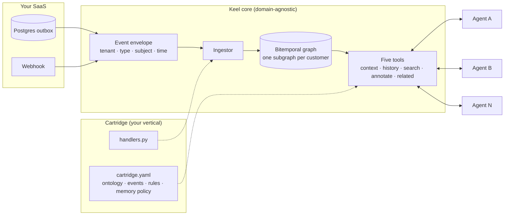

{/* Draft. The opening scene uses the sample stream in examples/events/fleet.jsonl (unit MXK-4821, tire T-9001). Swap in the real incident and the real product if you want to. Everything said about the code is true of keel 0.0.1. */}

The fourth agent is the one that broke me. Not because it was hard to build. Because it was easy, and I had built it before. Three times.

Here is the scene. A fleet-management SaaS. A truck, MXK-4821. One of its tires, T-9001, measured 5.2 mm of tread on September 10 and 2.6 mm on October 3. The product's rule says a tire is critical under 3 mm. Simple fact, simple rule. Now ask the four agents we had running whether that tire is OK.

The inspection agent says critical. It reads the inspections table directly and it saw the October measurement. The maintenance scheduler says there is nothing to schedule, because it only looks at open tickets and nobody opened one. The fuel-anomaly agent has no opinion about tires at all; it has never heard of them. And the support agent, the one that actually talks to the customer, says the tire is fine, because its context was assembled in September and nobody told it the world had moved.

Four agents, four answers, one tire.

That is not a bug in any of the four. Each one does exactly what it was built to do. The bug is that we built four of them, and under each one we built the same pipeline: extract the customer's data from our own database, normalize it into something a model can read, decide what "critical" means, give the agent a memory, expose tools to the model. Four copies of the customer's context. Four definitions of critical. Four memories that never talk to each other.

I spent a weekend writing down what it would take to not do that a fifth time. The result is [Keel](https://github.com/angelkurten/keel), which I am publishing today as open source, pre-alpha, with the thesis in the first line of the README: **stop rebuilding the pipeline for every agent.**

## The pipeline nobody budgets for

When you plan an agent, you budget for the agent: the prompt, the tools, the evals, the framework. What you actually spend most of the time on is everything under it.

Every agent inside a vertical SaaS needs the same five things before it can be useful. It needs to **extract** the slice of the customer's data that matters for its job. It needs to **normalize** that slice into a shape a model can reason about, because a `tires` table with eleven columns and three foreign keys is not that shape. It needs **semantics**: what counts as critical, what counts as expired, what counts as anomalous. It needs a **memory**, because an agent that concludes something on Monday and forgets it on Tuesday is a very expensive stateless function. And it needs **tools**, the surface the model calls.

None of that is the agent. All of it is the pipeline. And the pipeline is where the first agent's budget went, and the second's, and the third's.

The cost is not the code. Copying a pipeline is fast; that is exactly why we did it four times. The cost is drift. "Critical" was defined in four prompts, and two of them disagreed by the time anyone noticed. The support agent's cache was rebuilt nightly and the inspection agent's hourly, so for twenty-three hours a day they lived in different worlds. When the support agent learned something useful from a conversation, that knowledge went into its own memory and died there. The inspection agent could have used it. It never knew it existed.

And there was a question none of the four could answer, which is the one the customer's fleet manager asked first: *"When did you know?"* Not "is the tire critical" but "was it critical on October 3, and what did your system believe at the time?" Our database holds the current state of the world. It does not hold what was true on a date, nor what we believed on that date. Neither did any of the agents.

## What I tried before writing a line

I did not want to build infrastructure. I tried three things that already existed.

**Shared views in Postgres.** The obvious move: one set of views that every agent reads, so at least they read the same thing. It helped with drift for about a month. But a view is a copy of the current state. It has no time dimension, no record of when a fact was learned, and no place for anything an agent concludes. The memories stayed per agent. And the agents still had to normalize the view into something a model could use, so the normalization code still lived in four places.

**A memory layer.** There is a lot of good work here: Zep, Mem0, AgentCore Memory, the knowledge-graph products on top of Neo4j. I read their docs with real hope. As far as I can tell, they start from text. Conversations, documents, extracted entities. They model memory per user, or per assistant. That is the right design for the problem they solve, and it is not our problem. Our facts are not text; they are rows with timestamps that the SaaS already emits. And the unit of isolation is not the user. It is the end-customer of our customer, the tenant of the tenant, with its own fleet, its own rules, and its own right to not have its data mixed with the next fleet's. I could not find a layer that started from domain events and partitioned by that unit.

**RAG over our own data.** We tried indexing the tables and the operational docs and letting retrieval do the work. It gives probabilistic answers to questions that have exact answers. A tire's depth on October 3 is not something to retrieve with a similarity score. It is a fact, with a source, and we already have it.

Three attempts, same gap: nothing sat between "the SaaS emits events" and "an agent needs context", and that gap is exactly where we kept rebuilding.

## The shape that stuck

Keel is three decisions, and most of the code is just those decisions written down.

**Events are the truth.** The SaaS already produces domain events, or it produces writes that are events if you squint: an inspection was created, a tire was measured, a ticket changed status. Keel ingests those as envelopes with a tenant, a type, a subject, and two timestamps: when it happened in the world and when Keel learned about it. The ingest is deterministic. No LLM in the path, no network calls, no randomness. The graph is derived from the log, which means one tenant's whole subgraph can be wiped and rebuilt by replaying its events. If a state cannot be rebuilt from events, that state is a bug.

**The graph is bitemporal and per end-customer.** Every fact has a `valid_from` and a `valid_to` in world time, plus a `recorded_at` in Keel's time. When a new measurement arrives for the same tire, the previous fact is closed, not overwritten. So "the tire was critical on October 3" and "the tire is critical" are different queries and both work. Every fact carries provenance: the source, the event that justifies it, and who corrected it if a human or an agent did. And the graph holds pointers, not copies. An entity carries a reference to the row in the system of record and the two or three attributes a tool needs to label it. If someone sends a PR that copies a whole table into the graph, the PR is wrong.

**Five tools, and only five.** Every agent, in every domain, talks to the graph through the same five: `context`, `history`, `search`, `annotate`, `related`. They are plain Python functions first, and `keel serve` exposes the same five over MCP. New capability goes into the semantics of those five before anyone adds a sixth, because the names and signatures are the part that is supposed to be a standard.



The arrow that matters is the one from the cartridge. The core knows nothing about tires.

## Cartridges: the domain lives in one file

The thing that makes this reusable instead of a fleet-specific tool is that the domain is declared once, in a cartridge: a YAML file and a handlers module. The YAML names the entity kinds, the relations between them, the event catalog, the semantic rules, and the memory policy. This is the fleet one, trimmed:

```yaml
name: fleet

entities:
  unit:
    description: A vehicle in the customer's fleet.
    ref: vehicles.id
  tire:
    description: A tire mounted on a unit, tracked by position.
    ref: tires.id

relations:
  mounted_on: { from: tire, to: unit }

events:
  tire.depth_measured:
    subject: tire
    owner: tires
    payload: { unit_id: string, position: string, depth_mm: number }

rules:
  tire_critical:
    applies_to: tire
    definition: "A tire is critical when tread depth is below 3 mm."
    threshold_mm: 3

memory:
  ttl:
    tenant: never
    task: 14d
    agent: 1d
  requires_evidence: [global, tenant]
```

The handler for that event is the entire translation from payload to graph:

```python
@registry.on("tire.depth_measured")
def tire_depth(event, store):
    p = event.payload
    store.upsert_entity(event.tenant, "tire", event.subject_id, position=p["position"])
    store.link(event.tenant, event.subject, "mounted_on", f"unit:{p['unit_id']}", event.occurred_at, source=event.source)
    store.open_fact(event.tenant, event.subject, "depth_mm", p["depth_mm"], valid_from=event.occurred_at, source=event.source, evidence=event.id)
```

Three primitives. That is the whole write path: `upsert_entity`, `link`, `open_fact`, plus `unlink` and `close_fact` for the other direction. A handler is about ten lines. If it is growing past that, business logic is leaking into the wrong place, because the definition of "critical" does not live in the handler and it does not live in the agent. It lives in `rules`, in the graph, where the tools read it and every agent gets the same answer.

The rule I am enforcing hardest on myself is that the core stays domain-agnostic. No entity kind, no relation name, no predicate, no rule, no event type appears anywhere under `keel/`. The acceptance test for any change to the core is that two unrelated cartridges still pass without edits. The second cartridge in the repo is a small CRM for a hair salon: customers, appointments, payments. It has nothing in common with trucks, and it runs on the same core with zero changes. That is not a demo. That is the test that the thesis holds.

## What it looks like from the agent's side

The repository ships a minimal agent with no LLM in it, because the contract matters more than the model. It ingests the fleet stream, asks for the context of the truck, reads the tire rule from the graph instead of from a prompt, and writes back what it concluded as task-scoped memory with the measurement as evidence:

```python
tools = Tools(cartridge, store, tenant="acme-logistics")

for rel in tools.related("unit:MXK-4821", "mounted_on"):
    tire = tools.context(rel["subject"])
    threshold = tire["rules"]["tire_critical"]["threshold_mm"]
    depth = next(f for f in tire["facts"] if f["predicate"] == "depth_mm")
    if depth["value"] < threshold:
        tools.annotate(rel["subject"], "assessment", f"critical: {depth['value']} mm", scope="task", evidence=depth["evidence"], by="agent:tires")
```

And this is what `history` returns for the tire afterwards. The September fact is closed, not gone:

```text
depth_mm=5.2 valid 2026-09-10 -> 2026-10-03
depth_mm=2.6 valid 2026-10-03 -> now
assessment=critical: 2.6 mm < 3 mm valid 2026-10-14 -> now
```

The `annotate` call is where the memory design lives. Scopes go `global`, `tenant`, `task`, `agent`, from widest to narrowest. The agent above wrote at `task` scope, so its conclusion expires in fourteen days and is visible to any agent working the same task. If it wanted to promote that fact to `tenant` scope, where it never expires and every agent for that customer sees it, it would have to provide evidence, and the policy is enforced inside the tool. An agent that calls `annotate` at tenant scope with no evidence gets a `PermissionError`. The calling agent is not trusted to police itself. That one rule is what stops "a thing one agent guessed once" from becoming "a thing the whole system believes."

For a real agent, you run `keel serve` and point any MCP client at it. With Claude Code it is one line:

```bash
claude mcp add keel -- uv run --directory $PWD keel serve cartridges/fleet --tenant acme-logistics --events examples/events/fleet.jsonl
```

I tested this headless before publishing: I asked Claude, with only those five tools and no other context, whether any tire on the truck was below the critical threshold. It called `context` on the unit, `related` to find the tires, `context` on the tire, and answered correctly, including the 3 mm threshold, which it read from the rule in the graph and not from anything I told it. Three tool calls. No pipeline.

## What Keel does not solve

I would rather you read this list before you clone it.

**The store is in memory.** The graph dies with the process. The durable backend is the next item on the roadmap, and the constraint on choosing it is already decided: if a graph database forces an LLM into the ingest path to handle structured events, I will use only its storage and keep Keel's deterministic ingest. SQLite is an acceptable intermediate step.

**There is no consolidation.** Task and agent memory expires. Summarizing old episodic facts into durable ones is not designed yet, and I do not want to design it before seeing real agents produce real memory.

**One tenant, one cartridge.** Composing cartridges is a later decision.

**It has not run against a production stream yet.** It runs against sample streams and against a Postgres outbox table and a webhook in tests. The first real stream, from the first design customer, is the exit criterion for this phase.

**It is not an agent framework, and it is not RAG.** Your agents live in LangGraph, the Claude SDK, ADK, wherever. Keel is what they consult. And if your context is documents, there are good tools for that already; Keel can point at their output but it will not ingest text.

**The outbox cursor has a known edge.** The Postgres adapter follows a serial column, and under concurrent writers a row that commits late can be skipped. One writer per table, or a cursor with a lag, is the answer; the caveat is in the code with the upgrade path next to it.

## When to use it and when not

**Use it if:**
- You run a vertical B2B SaaS and you have, or are about to have, more than one agent on the same customer data.
- Your facts are structured events with time, not conversations.
- Your customers ask "when did you know" and you need the answer to be auditable.
- You want agents to share what they learn, with a policy on what gets promoted and what expires.

**Do not use it if:**
- You are building a single assistant over documents. A memory layer or RAG is the right tool and Keel will feel like overhead.
- Your product is consumer-facing with memory per user. The tenant-of-the-tenant model is not your shape.
- You need a durable store today. Wait for 0.1 or come help build it.

## What I am asking

Ten minutes gets you the demo:

```bash
git clone https://github.com/angelkurten/keel && cd keel
uv sync --extra dev
uv run keel validate cartridges/fleet
uv run keel context cartridges/fleet examples/events/fleet.jsonl unit:MXK-4821
```

Twenty more minutes gets you [a cartridge for your own vertical](https://angelkurten.github.io/keel/first-cartridge/). If writing it forces you to change anything under `keel/`, that is the most valuable issue you can open, because it means the core is not as generic as I think it is. There is an issue template for exactly that.

I am building this in the open, ten to twenty hours a week, and the roadmap has a stop condition written into it: at thirty days, one issue, pull request or question from someone I do not know. At ninety days, enough traction to keep going, or I stop and write up why. I would rather say that out loud than pretend the project does not have a clock.

The code is at [github.com/angelkurten/keel](https://github.com/angelkurten/keel), the docs at [angelkurten.github.io/keel](https://angelkurten.github.io/keel/), Apache 2.0. The envelope, the cartridge format and the five tools are meant to be a standard, and they will always be free.

If your fourth agent is coming and you are about to copy the pipeline again, try this first. And if the shape is wrong, open an issue and tell me where. The point was never Keel. The point is that nobody should build the same pipeline four times to get four different answers about one tire.
